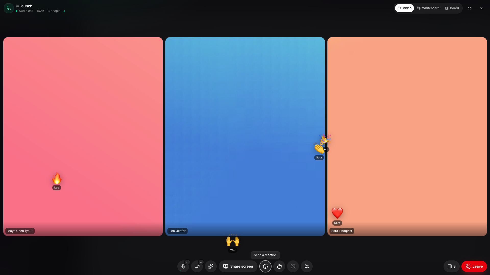

<div dir="rtl">

<p align="center">
  
</p>

<h1 align="center">Worklio</h1>

<p align="center">
  <strong>دردشة فريق مفتوحة المصدر تستضيفها بنفسك.</strong><br>
  قنوات وسلاسل نقاش ومكالمات واجتماعات سريعة ومستندات مشتركة ولوحات مهام وذكاء اصطناعي، على خوادمك الخاصة.
</p>

<p align="center">
  <a href="https://github.com/tanveersultan53/worklio/actions/workflows/ci.yml"></a>
  <a href="https://github.com/tanveersultan53/worklio/releases"></a>
  <a href="LICENSE"></a>
</p>

<p align="center">
  <a href="README.md">English</a> ·
  <a href="README.zh-CN.md">简体中文</a> ·
  <a href="README.ja.md">日本語</a> ·
  <a href="README.ko.md">한국어</a> ·
  <a href="README.es.md">Español</a> ·
  <a href="README.fr.md">Français</a> ·
  <a href="README.de.md">Deutsch</a> ·
  <a href="README.pt-BR.md">Português</a> ·
  <b>العربية</b> ·
  <a href="README.ur.md">اردو</a>
</p>

> هذه ترجمة لملف README الإنجليزي. عند وجود أي اختلاف، فإن [النسخة الإنجليزية](README.md) هي المرجع.

<p align="center">
  
</p>

## لماذا أنشأنا Worklio

أصبحت دردشة الفريق المكان الذي تُنجز فيه الشركات عملها، ومع ذلك تستأجرها معظم الفرق:

- **الفاتورة تكبر مع كل موظف جديد.** تُسعَّر الدردشة المستضافة عادةً لكل شخص شهريًا. أضف عشرة أشخاص وسترتفع الفاتورة حتى لو لم يتغير شيء آخر.
- **محادثاتك على خوادم شخص آخر.** القرارات وبيانات العملاء والخطط والملفات تُحفظ في قاعدة بيانات المزوّد وفق سياساته وفي منطقته.
- **أنت مقيَّد.** حدود السجل وقيود التصدير والميزات المحجوزة للباقات الأعلى تجعل المغادرة صعبة.
- **الذكاء الاصطناعي له شروط.** غالبًا ما تكلّف ميزات الذكاء الاصطناعي أكثر وترسل رسائلك إلى خدمات لم تخترها.

Worklio هو البديل: دردشة فريق كاملة وحديثة **تشغّلها بنفسك**. وهو مرخّص بموجب MIT، فيمكنك استخدامه وتعديله والبناء عليه مجانًا وإلى الأبد.

## ما الذي يتغير عندما تستضيفه بنفسك

| | دردشة فريق مستضافة نموذجية | Worklio |
|---|---|---|
| **التكلفة** | رسوم لكل شخص كل شهر | برنامج مجاني؛ تدفع فقط تكلفة خادمك |
| **مكان بياناتك** | سحابة المزوّد | خوادمك ومنطقتك ونسخك الاحتياطية |
| **سجل الرسائل** | محدود غالبًا في الباقات الأدنى | غير محدود؛ قاعدة البيانات ملكك |
| **الشيفرة المصدرية** | مغلقة | مفتوحة (MIT): اقرأها وراجعها وعدّلها |
| **الذكاء الاصطناعي** | تكلفة إضافية ونموذج يختاره المزوّد | استخدم مفتاحك: Claude أو Gemini أو DeepSeek |
| **المغادرة** | تصدير وترحيل | لا شيء تغادره؛ إنه ملكك أصلًا |

**مثال.** بسعر افتراضي قدره 10 دولارات لكل شخص شهريًا، يدفع فريق من 50 شخصًا **6,000 دولار سنويًا**، و**12,000 دولار** عندما يصل إلى 100 شخص. يعمل Worklio على خادم واحد؛ وبتكلفة افتراضية قدرها 40 دولارًا شهريًا يصبح المبلغ **480 دولارًا سنويًا**، سواء كان لديك 20 شخصًا أو 200. ستختلف أرقامك، لكن القاعدة واحدة: الدردشة المستضافة تكبر مع عدد الموظفين، وWorklio يكبر مع عتادك.

## ما الذي تحصل عليه

### تحدّث: محادثات منظّمة

قنوات ورسائل مباشرة وسلاسل نقاش، مع التفاعلات والاستطلاعات والرسائل المثبّتة والإشارات المرجعية والإرسال المجدول وأوامر الشرطة المائلة وفلاتر البحث. انتقل إلى أي رسالة مهما كانت قديمة.


### اجتمع: مكالمات ترنّ واجتماعات سريعة تنضم إليها

اتصل بزميل أو ابدأ اجتماعًا سريعًا في قناة. شارك شاشتك وارسم عليها، وتفاعل، وارفع يدك، ودوّن ملاحظات تصل إلى سلسلة النقاش، واعرض السبورة أو لوحة المهام للجميع. تعمل المكالمات عبر LiveKit داخل نشرك الخاص.



### أنشئ: مستندات ولوحات وسبورة بجانب الدردشة

لكل قناة مستند يكتبه الفريق معًا مباشرةً، ولوحة مهام بالأولويات والتسميات والمواعيد النهائية وعرض الجدول، وسبورة مشتركة.

| | |
|---|---|
|  |  |

### اسأل: ذكاء اصطناعي لا يرى إلا ما يمكنك رؤيته

اطرح أسئلة عن مساحة عملك واحصل على إجابات مع المصادر، وتابع القنوات المزدحمة، وأعد صياغة الرسائل أو ترجمها، وحوّل سلاسل النقاش إلى مهام. يستخدم Worklio AI صلاحيات البحث نفسها، فلا يعرض أبدًا رسالة لا يستطيع الشخص فتحها. استخدم مفتاحك الخاص من Claude أو Gemini أو DeepSeek، ويُخزَّن مشفّرًا.

### أدِر: الصلاحيات والثقة

أدوار (مالك، مسؤول، عضو، ضيف)، وصلاحيات تُطبَّق على الخادم، وروابط دعوة، وإدارة الأعضاء، وسجل تدقيق لكل تغيير حساس.

**[شاهد الشاشات الـ 46 كلها مع الوصف →](docs/SCREENSHOTS.md)**

## استضفه في خمس دقائق

تحتاج إلى Docker (مع Compose) وNode.js 22 وnpm.

```bash
git clone https://github.com/tanveersultan53/worklio.git && cd worklio
cp .env.example .env
make up
cd frontend && npm install && npm run dev
```

افتح http://localhost:3000، وأنشئ حسابًا ومساحة عمل، ثم ادعُ فريقك من **إعدادات مساحة العمل ← الدعوات**.

في بيئة الإنتاج، يشغّل `docker-compose.prod.yml` كل شيء على خادم واحد. الدليل خطوة بخطوة في [docs/DEPLOYMENT.md](docs/DEPLOYMENT.md).

## بياناتك وقواعدك

- يبقى كل شيء على بنيتك التحتية: الرسائل والملفات في Postgres الخاص بك وفي تخزين متوافق مع S3، والمكالمات عبر خادم LiveKit الخاص بك.
- يُطبَّق عزل مساحات العمل على الخادم في كل طلب.
- جلسات قصيرة مع رموز تحديث متجددة وحدود لمحاولات تسجيل الدخول.
- تُخزَّن مفاتيح الذكاء الاصطناعي مشفّرة ولا تُسجَّل ولا تُعرض مرة أخرى.

## المزيد

المرجع التقني (الخدمات والمنافذ والأوامر وهيكل المشروع) متاح في الوثائق الإنجليزية:

- [README (English)](README.md) · [docs/DEPLOYMENT.md](docs/DEPLOYMENT.md) · [docs/CONFIGURATION.md](docs/CONFIGURATION.md) · [docs/ARCHITECTURE.md](docs/ARCHITECTURE.md)
- [CONTRIBUTING.md](CONTRIBUTING.md) · [GOVERNANCE.md](GOVERNANCE.md) · [SECURITY.md](SECURITY.md) · [CODE_OF_CONDUCT.md](CODE_OF_CONDUCT.md)

## الترخيص

[MIT](LICENSE) © 2026 محمد تنوير سلطان والمساهمون في Worklio.

Worklio مشروع مستقل مفتوح المصدر، ولا يرتبط بشركة Slack Technologies, LLC أو Salesforce, Inc. ولا ترعاه أو تعتمده أيٌّ منهما.

</div>
