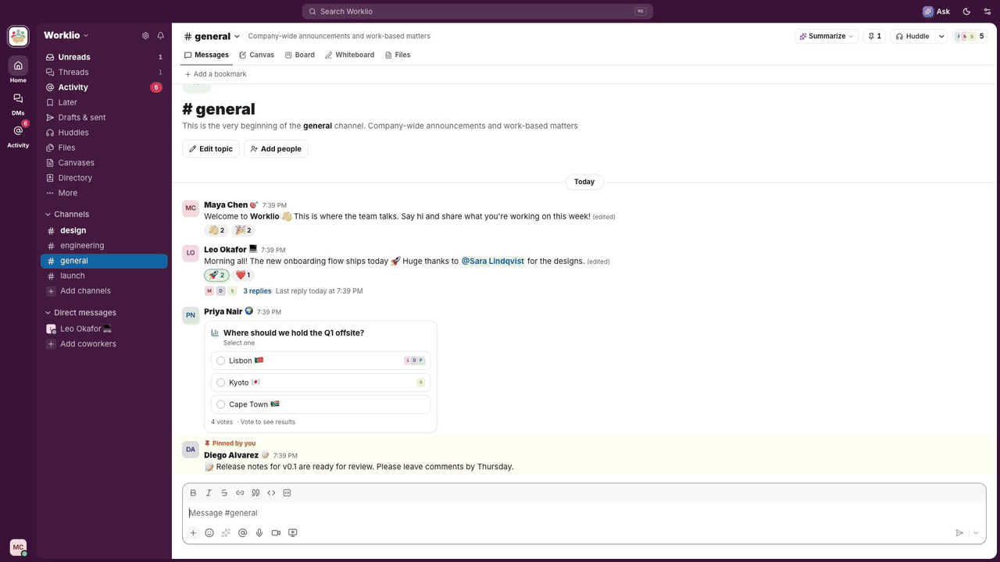

<p align="center">
  
</p>

<h1 align="center">Worklio</h1>

<p align="center">
  <strong>Chat de equipo de código abierto que alojas tú mismo.</strong><br>
  Canales, hilos, llamadas y reuniones rápidas, documentos compartidos, tableros e IA, en tus propios servidores.
</p>

<p align="center">
  <a href="https://github.com/tanveersultan53/worklio/actions/workflows/ci.yml"></a>
  <a href="https://github.com/tanveersultan53/worklio/releases"></a>
  <a href="LICENSE"></a>
</p>

<p align="center">
  <a href="README.md">English</a> ·
  <a href="README.zh-CN.md">简体中文</a> ·
  <a href="README.ja.md">日本語</a> ·
  <a href="README.ko.md">한국어</a> ·
  <b>Español</b> ·
  <a href="README.fr.md">Français</a> ·
  <a href="README.de.md">Deutsch</a> ·
  <a href="README.pt-BR.md">Português</a> ·
  <a href="README.ar.md">العربية</a> ·
  <a href="README.ur.md">اردو</a>
</p>

> Esta es una traducción del README en inglés. Si hay diferencias, la [versión en inglés](README.md) es la de referencia.

<p align="center">
  
</p>

## Por qué creamos Worklio

El chat de equipo se ha convertido en el lugar donde las empresas trabajan. Aun así, la mayoría de los equipos lo alquilan:

- **La factura crece con cada contratación.** El chat alojado suele cobrarse por persona y por mes. Si sumas diez personas, la factura sube aunque nada más cambie.
- **Tus conversaciones viven en los servidores de otro.** Decisiones, datos de clientes, planes y archivos quedan en la base de datos de un proveedor, bajo sus políticas y en su región.
- **Quedas atrapado.** Los límites de historial, las restricciones de exportación y las funciones reservadas a planes superiores dificultan irse.
- **La IA viene con condiciones.** Las funciones de IA suelen costar más y envían tus mensajes a servicios que no elegiste.

Worklio es la alternativa: un chat de equipo completo y moderno que **operas tú**. Tiene licencia MIT, así que puedes usarlo, modificarlo y ampliarlo gratis, para siempre.

## Qué cambia cuando lo alojas tú

| | Chat de equipo alojado típico | Worklio |
|---|---|---|
| **Costo** | Una tarifa por persona, cada mes | Software gratuito; solo pagas tu servidor |
| **Dónde están tus datos** | En la nube del proveedor | En tus servidores, tu región, tus copias |
| **Historial de mensajes** | A menudo limitado en planes bajos | Ilimitado; la base de datos es tuya |
| **Código fuente** | Cerrado | Abierto (MIT): léelo, audítalo y cámbialo |
| **IA** | Costo extra, modelo elegido por el proveedor | Usa tu propia clave: Claude, Gemini o DeepSeek |
| **Salir** | Exportaciones y migraciones | Nada que dejar; ya es tuyo |

**Un ejemplo.** Con un precio de ejemplo de 10 USD por persona al mes, un equipo de 50 personas paga **6.000 USD al año**, y **12.000 USD** cuando crece a 100. Worklio funciona en un solo servidor; con un costo de ejemplo de 40 USD al mes, son **480 USD al año**, tengas 20 personas o 200. Tus cifras serán distintas, pero la tendencia no: el chat alojado crece con la plantilla y Worklio crece con tu hardware.

## Qué obtienes

### Hablar: conversaciones ordenadas

Canales, mensajes directos e hilos, con reacciones, encuestas, mensajes fijados, marcadores, envíos programados, comandos con barra y filtros de búsqueda. Salta a cualquier mensaje, por antiguo que sea.


### Reunirse: llamadas que suenan y reuniones a las que te sumas

Llama a un compañero o inicia una reunión en un canal. Comparte tu pantalla y dibuja sobre ella, reacciona, levanta la mano, toma notas que quedan en el hilo y lleva la pizarra o el tablero al escenario. Las llamadas usan LiveKit dentro de tu propia instalación.


### Crear: documentos, tableros y pizarras junto al chat

Cada canal tiene un documento que el equipo escribe en tiempo real, un tablero con prioridades, etiquetas, fechas límite y vista de tabla, y una pizarra compartida.

| | |
|---|---|
|  |  |

### Preguntar: IA que solo ve lo que tú puedes ver

Haz preguntas sobre tu espacio de trabajo y obtén respuestas con fuentes, ponte al día con canales activos, reescribe o traduce mensajes y convierte hilos en tareas. Worklio AI consulta con los mismos permisos que la búsqueda, así que nunca muestra un mensaje que alguien no podría abrir. Usa tu propia clave de Claude, Gemini o DeepSeek; se guarda cifrada.

### Administrar: permisos y confianza

Roles (propietario, administrador, miembro, invitado), permisos aplicados en el servidor, enlaces de invitación, gestión de miembros y un registro de auditoría de cada cambio sensible.

**[Ver las 46 pantallas con descripciones →](docs/SCREENSHOTS.md)**

## Alójalo en cinco minutos

Necesitas Docker (con Compose), Node.js 22 y npm.

```bash
git clone https://github.com/tanveersultan53/worklio.git && cd worklio
cp .env.example .env
make up
cd frontend && npm install && npm run dev
```

Abre http://localhost:3000, crea una cuenta y un espacio de trabajo, e invita a tu equipo desde **Configuración del espacio de trabajo → Invitaciones**.

En producción, `docker-compose.prod.yml` ejecuta todo en un servidor. La guía paso a paso está en [docs/DEPLOYMENT.md](docs/DEPLOYMENT.md).

## Tus datos, tus reglas

- Todo queda en tu infraestructura: mensajes y archivos en tu Postgres y tu almacenamiento compatible con S3, llamadas a través de tu propio servidor LiveKit.
- El aislamiento entre espacios de trabajo se aplica en el servidor en cada solicitud.
- Sesiones cortas con tokens de actualización rotativos y límites de intentos de inicio de sesión.
- Las claves de IA se guardan cifradas y nunca se registran ni se vuelven a mostrar.

## Más información

La referencia técnica (servicios y puertos, comandos, estructura del proyecto) está en la documentación en inglés:

- [README (English)](README.md) · [docs/DEPLOYMENT.md](docs/DEPLOYMENT.md) · [docs/CONFIGURATION.md](docs/CONFIGURATION.md) · [docs/ARCHITECTURE.md](docs/ARCHITECTURE.md)
- [CONTRIBUTING.md](CONTRIBUTING.md) · [GOVERNANCE.md](GOVERNANCE.md) · [SECURITY.md](SECURITY.md) · [CODE_OF_CONDUCT.md](CODE_OF_CONDUCT.md)

## Licencia

[MIT](LICENSE) © 2026 Muhammad Tanveer Sultan y los colaboradores de Worklio.

Worklio es un proyecto independiente de código abierto. No está afiliado, patrocinado ni respaldado por Slack Technologies, LLC ni Salesforce, Inc.
