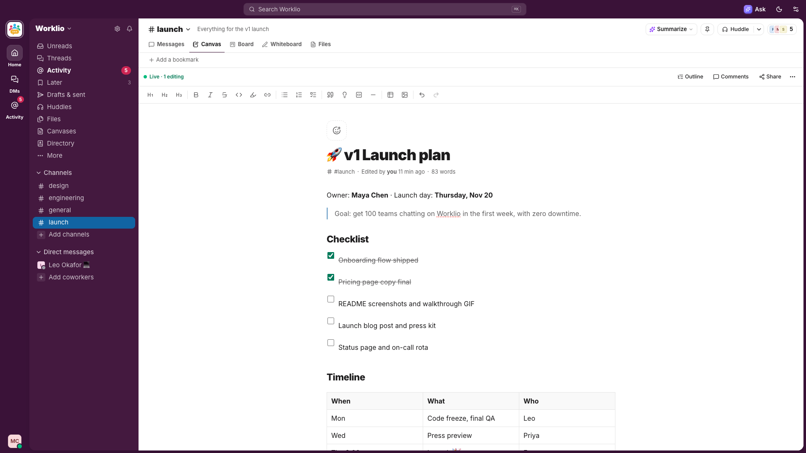

<p align="center">
  
</p>

<h1 align="center">Worklio</h1>

<p align="center">
  <strong>自分でホストできるオープンソースのチームチャット。</strong><br>
  チャンネル、スレッド、通話とハドル、共有ドキュメント、ボード、AI。すべてあなたのサーバーで。
</p>

<p align="center">
  <a href="https://github.com/tanveersultan53/worklio/actions/workflows/ci.yml"></a>
  <a href="https://github.com/tanveersultan53/worklio/releases"></a>
  <a href="LICENSE"></a>
</p>

<p align="center">
  <a href="README.md">English</a> ·
  <a href="README.zh-CN.md">简体中文</a> ·
  <b>日本語</b> ·
  <a href="README.ko.md">한국어</a> ·
  <a href="README.es.md">Español</a> ·
  <a href="README.fr.md">Français</a> ·
  <a href="README.de.md">Deutsch</a> ·
  <a href="README.pt-BR.md">Português</a> ·
  <a href="README.ar.md">العربية</a> ·
  <a href="README.ur.md">اردو</a>
</p>

> これは英語版 README の翻訳です。内容に差異がある場合は [英語版](README.md) が正となります。

<p align="center">
  
</p>

## Worklio をつくった理由

チームチャットは会社の仕事の中心になりました。それでも、ほとんどのチームはそれを「借りて」います。

- **人が増えるほど料金が増える。** ホスト型チャットは多くの場合、1 人あたり月額課金です。10 人増えれば、ほかに何も変わらなくても料金が上がります。
- **会話は他社のサーバーにある。** 意思決定、顧客情報、計画、ファイルが、ベンダーのポリシーと地域のもとで、ベンダーのデータベースに保存されます。
- **乗り換えが難しい。** 履歴の制限、エクスポートの制限、上位プラン限定の機能があり、離れにくくなっています。
- **AI には条件がある。** AI 機能は追加料金になることが多く、あなたが選んでいないサービスにメッセージが送られます。

Worklio はその代わりになる、完全でモダンなチームチャットです。**自分で運用**できます。MIT ライセンスなので、無料で、ずっと、使い、変更し、発展させることができます。

## 自分でホストすると何が変わるか

| | 一般的なホスト型チームチャット | Worklio |
|---|---|---|
| **費用** | 毎月、1 人あたりの料金 | ソフトウェアは無料。かかるのはサーバー代だけ |
| **データの保存場所** | ベンダーのクラウド | あなたのサーバー、地域、バックアップ |
| **メッセージ履歴** | 下位プランでは制限があることも | 無制限。データベースはあなたのもの |
| **ソースコード** | 非公開 | 公開（MIT）。読む・監査する・変更する |
| **AI** | 追加料金、モデルはベンダー次第 | 自分のキーを利用：Claude、Gemini、DeepSeek |
| **乗り換え** | エクスポートと移行 | 不要。最初からあなたのもの |

**例：** 1 人あたり月 10 ドルという例の料金なら、50 人のチームで年 **6,000 ドル**、100 人になると **12,000 ドル** です。Worklio は 1 台のサーバーで動きます。例として月 40 ドルなら年 **480 ドル**、20 人でも 200 人でも同じです。実際の数字は違っても傾向は同じです。ホスト型は人数に比例し、Worklio はハードウェアに比例します。

## できること

### 話す：整理された会話

チャンネル、DM、スレッド。リアクション、投票、ピン留め、ブックマーク、予約送信、スラッシュコマンド、検索フィルター。どんなに古いメッセージにもジャンプできます。


### 会う：鳴る通話、気軽に参加できるハドル

チームメイトに発信したり、チャンネルでハドルを始めたり。画面を共有して書き込み、リアクションや挙手、スレッドに残るメモ、ホワイトボードやボードをステージに表示。通話はあなたのデプロイ内の LiveKit で動きます。


### つくる：チャットの横にドキュメント、ボード、ホワイトボード

各チャンネルに、チームでリアルタイム共同編集できるキャンバス、優先度・ラベル・期日・テーブル表示のあるボード、共有ホワイトボードがあります。

| | |
|---|---|
|  |  |

### 聞く：あなたが見られるものだけを見る AI

ワークスペースについて質問すると出典付きで回答、忙しいチャンネルの要約、メッセージの書き換えや翻訳、スレッドからタスク作成。Worklio AI は検索と同じ権限チェックを通るので、開けないメッセージを見せることはありません。Claude、Gemini、DeepSeek の自分のキーを使えて、キーは暗号化して保存されます。

### 運用する：管理、権限、信頼

ロール（オーナー、管理者、メンバー、ゲスト）、サーバー側で強制される権限、招待リンク、メンバー管理、重要な変更をすべて記録する監査ログ。

**[46 画面すべてを説明付きで見る →](docs/SCREENSHOTS.md)**

## 5 分でセルフホスト

必要なもの：Docker（Compose 付き）、Node.js 22、npm。

```bash
git clone https://github.com/tanveersultan53/worklio.git && cd worklio
cp .env.example .env
make up
cd frontend && npm install && npm run dev
```

http://localhost:3000 を開き、アカウントとワークスペースを作成して、**ワークスペース設定 → 招待** からチームを招待します。

本番環境では `docker-compose.prod.yml` で 1 台のサーバーにすべてを起動できます。手順は [docs/DEPLOYMENT.md](docs/DEPLOYMENT.md) を参照してください。

## あなたのデータは、あなたのもの

- すべてがあなたのインフラにとどまります。メッセージとファイルはあなたの Postgres と S3 互換ストレージ、通話はあなたの LiveKit サーバー経由です。
- テナントの分離はすべてのリクエストでサーバー側で強制されます。
- 短命なセッション、ローテーションするリフレッシュトークン、サインインのレート制限。
- AI キーは暗号化して保存され、ログに残らず、再表示もされません。

## 詳しく

技術的なリファレンス（サービスとポート、コマンド、構成）は英語のドキュメントをご覧ください：

- [README (English)](README.md) · [docs/DEPLOYMENT.md](docs/DEPLOYMENT.md) · [docs/CONFIGURATION.md](docs/CONFIGURATION.md) · [docs/ARCHITECTURE.md](docs/ARCHITECTURE.md)
- [CONTRIBUTING.md](CONTRIBUTING.md) · [GOVERNANCE.md](GOVERNANCE.md) · [SECURITY.md](SECURITY.md) · [CODE_OF_CONDUCT.md](CODE_OF_CONDUCT.md)

## ライセンス

[MIT](LICENSE) © 2026 Muhammad Tanveer Sultan と Worklio のコントリビューター。

Worklio は独立したオープンソースプロジェクトであり、Slack Technologies, LLC および Salesforce, Inc. とは提携・後援・承認の関係にありません。
