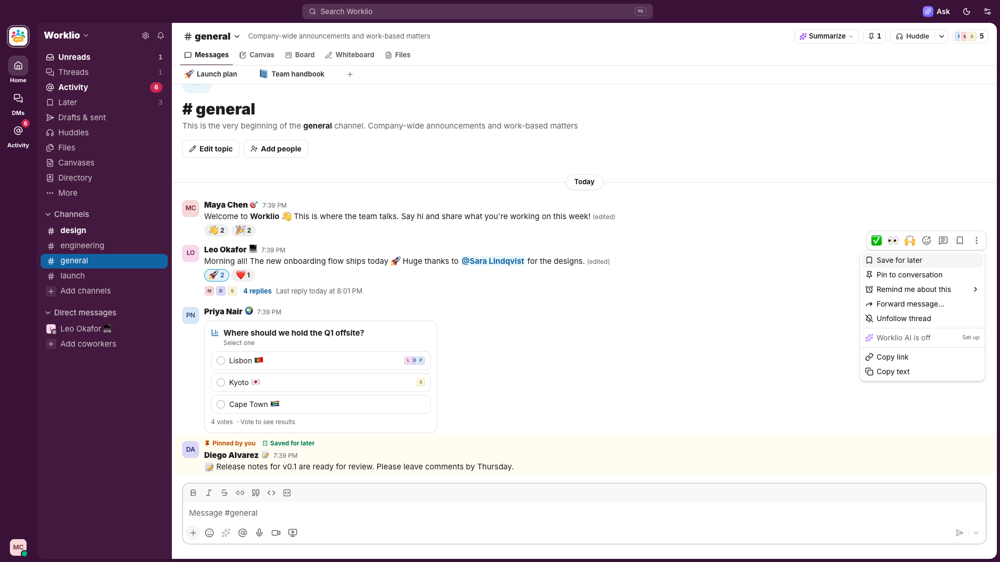
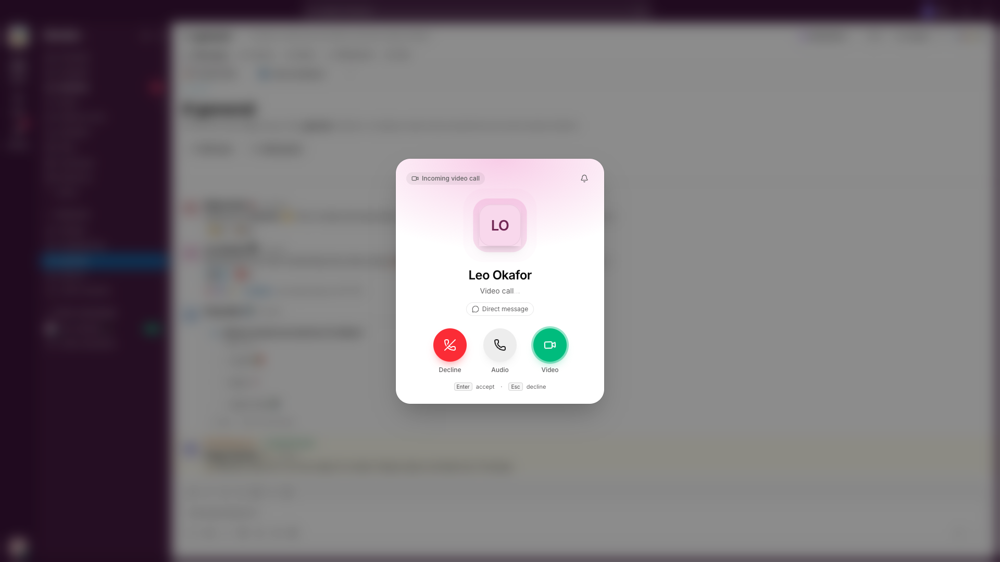
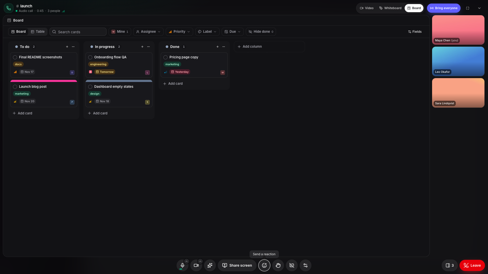
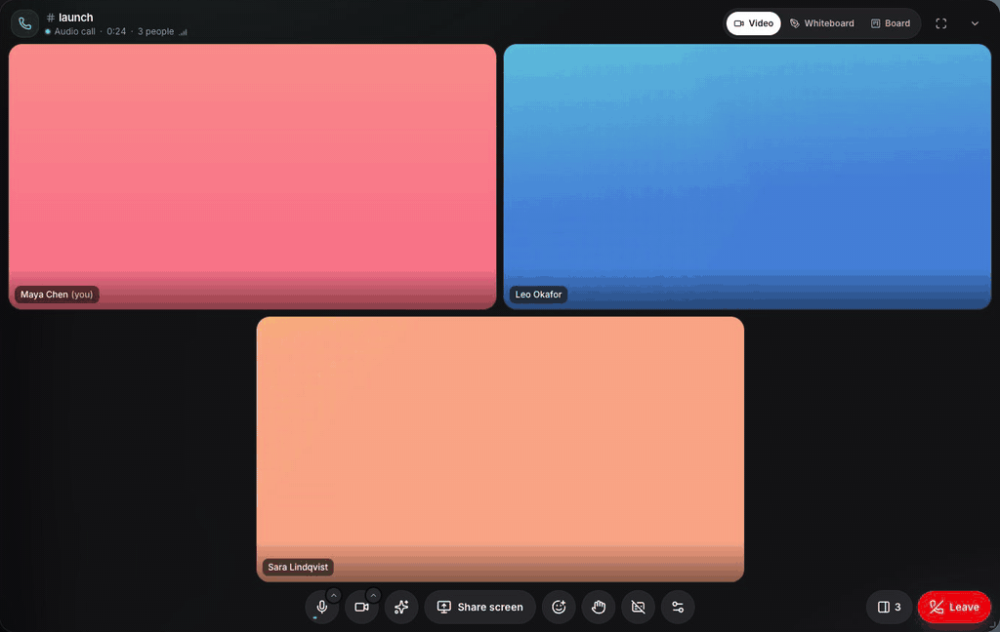
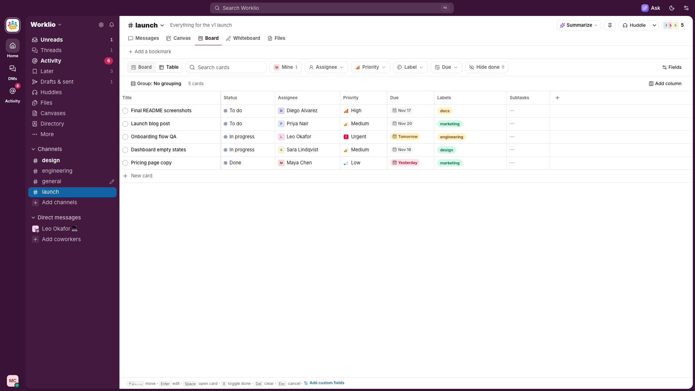
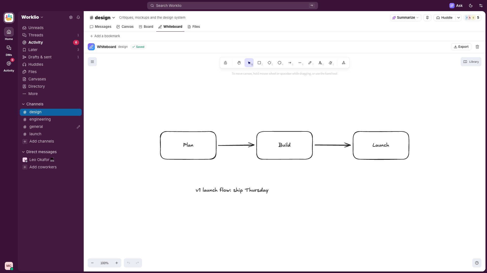
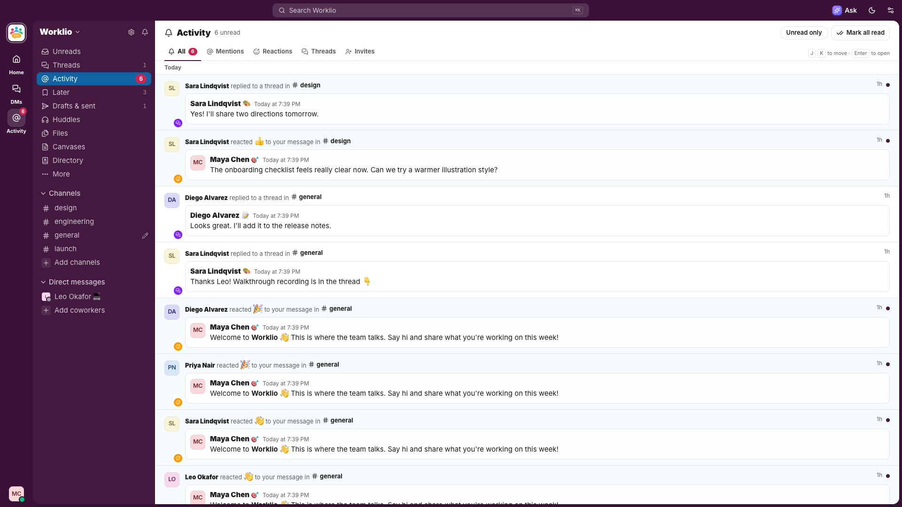
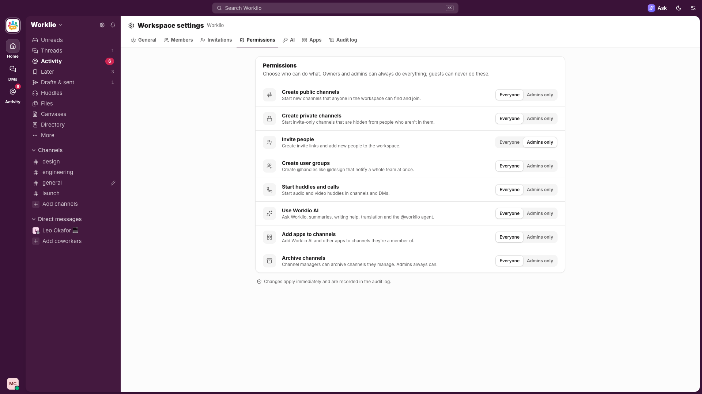

<p align="center">
  
</p>

<h1 align="center">Worklio</h1>

<p align="center">
  <strong>Open-source team chat you host yourself.</strong><br>
  Channels, threads, calls and huddles, shared docs, boards and AI, on your own servers.
</p>

<p align="center">
  <a href="https://github.com/tanveersultan53/worklio/actions/workflows/ci.yml"></a>
  <a href="https://github.com/tanveersultan53/worklio/releases"></a>
  <a href="LICENSE"></a>
  <a href="CONTRIBUTING.md"></a>
  <a href="https://github.com/sponsors/tanveersultan53"></a>
</p>

<p align="center">
  <strong>❤️ Worklio is free and independent. <a href="https://github.com/sponsors/tanveersultan53">Sponsor it on GitHub</a> to keep it that way.</strong>
</p>

<p align="center">
  <b>English</b> ·
  <a href="README.zh-CN.md">简体中文</a> ·
  <a href="README.ja.md">日本語</a> ·
  <a href="README.ko.md">한국어</a> ·
  <a href="README.es.md">Español</a> ·
  <a href="README.fr.md">Français</a> ·
  <a href="README.de.md">Deutsch</a> ·
  <a href="README.pt-BR.md">Português</a> ·
  <a href="README.ar.md">العربية</a> ·
  <a href="README.ur.md">اردو</a>
</p>

<p align="center">
  
</p>

## Why we built Worklio

Team chat has become the place where companies do their work. Yet most teams rent it:

- **The bill grows with every hire.** Hosted chat is usually priced per person, per month. Add ten people and the bill goes up whether or not anything else changed.
- **Your conversations live on someone else's servers.** Decisions, customer details, plans and files sit in a vendor's database, under their policies and in their region.
- **You're locked in.** History limits, export restrictions and features held back for higher plans make it hard to leave.
- **AI comes with strings.** AI features often cost extra and send your messages to services you didn't choose.

Worklio is the alternative: a complete, modern team chat that you **run yourself**. It's MIT licensed, so you can use it, change it and build on it for free, forever.

## What changes when you host it

| | Typical hosted team chat | Worklio |
|---|---|---|
| **Cost** | A fee per person, every month | Free software; you pay only for your server |
| **Where your data lives** | The vendor's cloud | Your servers, your region, your backups |
| **Message history** | Often limited on lower plans | Unlimited; it's your database |
| **Source code** | Closed | Open (MIT): read, audit and change everything |
| **AI** | Extra cost, vendor's choice of model | Bring your own key: Claude, Gemini or DeepSeek |
| **Leaving** | Exports and migrations | Nothing to leave; you already own it |

**An example.** At an example price of $10 per person per month, a 50-person team pays **$6,000 a year**, and **$12,000** when it grows to 100. Worklio runs on a single server; at an example cost of $40 a month, that's **$480 a year**, whether you have 20 people or 200. Your numbers will differ, but the shape won't: hosted chat scales with headcount, Worklio scales with your hardware.

## What you get

### Talk: conversations that stay organised

Channels, DMs and threads, with reactions, polls, pins, bookmarks, scheduled messages, slash commands and search filters. Jump to any message, however old.

| | |
|---|---|
|  |  |
|  |  |

### Meet: calls that ring, huddles you drop into

Ring a teammate, start a huddle in a channel, or schedule one for later: it lands on everyone's calendar, reminds them 10 minutes before and rings when it starts. Share your screen and draw on it, react, raise a hand, take notes that land in the thread, and bring the whiteboard or board onto the stage. Calls run on LiveKit inside your own deployment.

| | |
|---|---|
|  |  |
|  |  |

<p align="center">
  
</p>

### Make: docs, boards and whiteboards beside the chat

Every channel has a canvas the team writes together live, a board with priorities, labels, due dates and a table view, and a shared whiteboard.

| | |
|---|---|
|  |  |
|  |  |

### Ask: AI that only sees what you can see

Ask questions about your workspace with sources, catch up on busy channels, rewrite or translate messages, turn threads into tasks, and add the @worklio agent to channels. Worklio AI looks things up through the same permission checks as search, so it can never show someone a message they couldn't open. Bring your own Claude, Gemini or DeepSeek key; it's encrypted at rest.

| | |
|---|---|
|  |  |

### Stay on top: your personal views

Activity, Threads, Unreads, Later (saved messages and to-dos), Drafts & sent, Huddles, Files, Canvases and a Directory of people and channels.

| | |
|---|---|
|  |  |

### Run it: admin, permissions and trust

Roles (owner, admin, member, guest), permissions enforced on the server, invite links, member management and an audit log of every sensitive change.

| | |
|---|---|
|  |  |

**[See all 46 screens with descriptions →](docs/SCREENSHOTS.md)**

## Self-host in five minutes

You need Docker (with Compose), Node.js 22 and npm.

```bash
git clone https://github.com/tanveersultan53/worklio.git && cd worklio
cp .env.example .env            # dev defaults, no edits needed
make up                         # database, storage, API, workers, scheduler and calls
cd frontend && npm install && npm run dev
```

Open http://localhost:3000, create an account and a workspace, then invite your team from **Workspace settings → Invitations**.

To see Worklio full of realistic content, seed the demo workspace with fictional people:

```bash
python3 scripts/seed_demo.py /tmp/worklio-demo.json   # the JSON file contains the demo logins
```

### Desktop app

Worklio has a desktop app for macOS, Windows and Linux in [`desktop/`](desktop/). It opens your server in its own window with a dock or taskbar unread badge, notifications while you're in another app, and a screen-share picker. On first launch it asks for your server's address. To try it against a local server:

```bash
cd desktop && npm install && npm start
```

Installers are built by GitHub Actions; see [desktop/README.md](desktop/README.md).

### Going to production

`docker-compose.prod.yml` runs the whole stack on one server with non-root images, security headers and startup checks that refuse weak secrets. Put a TLS reverse proxy in front and you're done; the step-by-step guide, with a Caddy example, is in **[docs/DEPLOYMENT.md](docs/DEPLOYMENT.md)**.

## Your data, your rules

- **Everything stays on your infrastructure:** messages and files in your Postgres and your S3-compatible storage, calls through your own LiveKit server.
- **Tenant isolation is enforced on the server** for every request; people outside a workspace can't even tell it exists.
- **Short-lived sessions with rotating refresh tokens**, reuse detection and rate limits on sign-in.
- **AI keys are encrypted at rest** and never logged or shown again; AI only sees what the asking person can read.
- **Audit log** of roles, access, settings, invitations, AI and apps.

Read [SECURITY.md](SECURITY.md) for the full security model and the production checklist.

## Tech stack

| Layer | Technology |
|---|---|
| API | Python 3.12+ (Docker uses 3.13), FastAPI, async SQLAlchemy 2, Alembic, Pydantic |
| Database | PostgreSQL 17 (`pgvector/pgvector:pg17` image) |
| Realtime and cache | Redis 7 (pub/sub, presence, rate limits) over a single WebSocket per tab |
| Background jobs | Celery worker and Celery beat (Redis broker) |
| Files | Any S3-compatible store; SeaweedFS in development |
| Calls | LiveKit server 1.9 |
| Collaboration | Yjs on the client, pycrdt on the server, Excalidraw |
| AI | Anthropic SDK (Claude), OpenAI-compatible SDK (Gemini, DeepSeek) |
| Web app | Next.js 16 (App Router), React 19 (React Compiler lint rules), TypeScript, Tailwind CSS v4, shadcn/ui on Base UI, TipTap v3, livekit-client |

## Reference

- `make up` runs `docker compose up -d --build`. It starts Postgres, Redis, SeaweedFS, the API, the Celery worker, Celery beat and LiveKit. The API applies migrations on start.
- `make web` is a shortcut for `cd frontend && npm run dev`.
- The web app talks to `http://localhost:8000` by default. To change that, copy `frontend/.env.example` to `frontend/.env.local` and edit it.
- AI is optional. Set `ANTHROPIC_API_KEY` in `.env`, or add a Claude, Gemini or DeepSeek key in **Workspace settings → AI**. Without a key, AI endpoints answer `503 ai_not_configured`.

### Services and ports

| Service | Compose name | Host port | Notes |
|---|---|---|---|
| Web app | (runs on host) | 3000 | `npm run dev` |
| API | `api` | 8000 | OpenAPI docs at http://localhost:8000/docs, WebSocket at `/ws` |
| Postgres | `postgres` | 5432 | user/password/db `worklio` |
| Redis | `redis` | 6380 (→ 6379) | 6380 avoids clashing with a local Redis |
| S3 (SeaweedFS) | `s3` | 8333 | creds in `infra/seaweedfs/s3.json`, must match `.env` |
| LiveKit | `livekit` | 7880, 7881, 7882/udp | `--dev` mode, key `devkey` / secret `secret` |
| Celery worker | `worker` | none | link previews, AI agent, call summaries |
| Celery beat | `beat` | none | reminders, scheduled sends, orphan-upload cleanup. Must run. |

### Common commands

| Command | What it does |
|---|---|
| `make up` | Build and start all backend services |
| `make down` | Stop them |
| `make logs` | Tail `api` and `worker` logs |
| `make test` | Run the backend tests inside the `api` container (needs the stack running) |
| `make migrate` | Apply Alembic migrations |
| `make revision m="add something"` | Autogenerate a migration from model changes |
| `make api-shell` | Open a shell in the `api` container |
| `make web` | Run the Next.js dev server |
| `cd frontend && npx tsc --noEmit && npm run lint` | Type-check and lint the web app |

## Project layout

```
backend/            FastAPI app, Alembic migrations, tests  (see backend/README.md)
  app/api/          routes and deps.py (auth + tenant isolation)
  app/realtime/     WebSocket endpoint, Redis pub/sub hub, huddle state
  app/ai/           AI providers, retrieval tools, agent, captions, key encryption
  app/workers/      Celery app, periodic and background tasks
  app/models/       SQLAlchemy models
desktop/            Electron desktop app for macOS, Windows, Linux  (see desktop/README.md)
frontend/           Next.js web app  (see frontend/README.md)
  src/app/          routes (/login, /new, /invite/[token], /w/[workspaceId]/...)
  src/components/   feature folders (chat, workspace, calls, huddle, canvas, board, ai, admin, ...)
  src/lib/          API client, realtime reducers, appearance, stores
  src/hooks/        use-realtime (WebSocket), use-message-jump
infra/seaweedfs/    dev S3 credentials
docs/               architecture, configuration, deployment, roadmap, lessons learned
```

## Documentation

| Document | What it covers |
|---|---|
| [docs/ARCHITECTURE.md](docs/ARCHITECTURE.md) | System design, realtime flow, design rules, WebSocket events, subsystems |
| [docs/CONFIGURATION.md](docs/CONFIGURATION.md) | Every environment variable, with defaults |
| [docs/DEPLOYMENT.md](docs/DEPLOYMENT.md) | Running Worklio in production with Docker |
| [docs/PRODUCT_BLUEPRINT.md](docs/PRODUCT_BLUEPRINT.md) | Every feature and its verified status |
| [docs/SCREENSHOTS.md](docs/SCREENSHOTS.md) | Every screen, in Full HD, with what it does |
| [docs/ROADMAP.md](docs/ROADMAP.md) | What comes next |
| [docs/LESSONS_LEARNED.md](docs/LESSONS_LEARNED.md) | Pitfalls we hit and how we fixed them |
| [backend/README.md](backend/README.md) | Working on the API |
| [frontend/README.md](frontend/README.md) | Working on the web app |
| [CONTRIBUTING.md](CONTRIBUTING.md) | How to contribute |
| [CODE_OF_CONDUCT.md](CODE_OF_CONDUCT.md) | Community standards |
| [GOVERNANCE.md](GOVERNANCE.md) | Roles, how to become a maintainer, how changes reach `main` |
| [SECURITY.md](SECURITY.md) | Reporting vulnerabilities, security model, production checklist |
| [CHANGELOG.md](CHANGELOG.md) | Release notes |

## Known limitations

- The message list is not virtualized (very long scroll-backs keep every loaded message in the page).
- Threads load up to 2,000 replies; search pages up to 1,000 results.
- Member and channel lists load in full (fine for hundreds of people, not tens of thousands).
- No web push, email invitations, PWA or huddle recording yet. Scheduled meetings don't repeat yet.
- No Playwright end-to-end suite yet.
- Desktop builds aren't code-signed yet, so macOS and Windows warn on first open, and the app doesn't update itself.

See [docs/ROADMAP.md](docs/ROADMAP.md) for what's planned.

Before running Worklio anywhere other than your laptop, read the production checklist in
[SECURITY.md](SECURITY.md).

## Support Worklio

<p>
  <a href="https://github.com/sponsors/tanveersultan53"></a>
</p>

**Worklio is free and always will be.** If it saves your team money or keeps your data where it belongs, please consider supporting its development:

- **[Sponsor on GitHub](https://github.com/sponsors/tanveersultan53)**, one-off or monthly. Sponsors pay for docs and demo hosting, code signing for the desktop apps, and time to ship the roadmap.
- **Star the repository** and share it with teams who pay too much for chat.
- **Contribute** code, docs, translations or bug reports.

Funding pays for maintenance, security fixes, hosting for the demo and docs, and new features from the [roadmap](https://github.com/tanveersultan53/worklio/issues/24). Companies that rely on Worklio can sponsor to prioritise the work they need.

## Contributing

Contributions are welcome. Read [CONTRIBUTING.md](CONTRIBUTING.md) for setup, checks and the
pull request checklist, and follow the [Code of Conduct](CODE_OF_CONDUCT.md). Please report
security issues privately as described in [SECURITY.md](SECURITY.md).

## License

[MIT](LICENSE) © 2026 Muhammad Tanveer Sultan and Worklio contributors.

## Trademarks

Worklio is an independent open-source project. It is not affiliated with, sponsored by or endorsed
by Slack Technologies, LLC or Salesforce, Inc. "Slack" is a trademark of its owner, and any mention
of it here is only for comparison.
