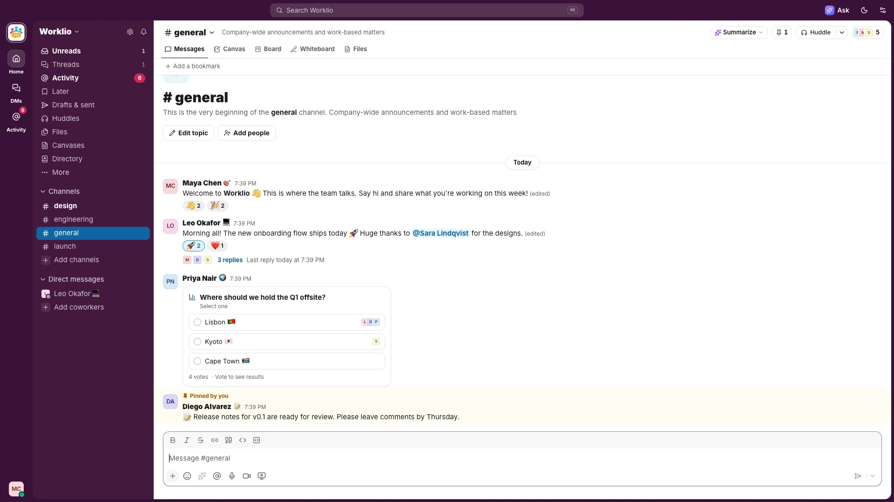
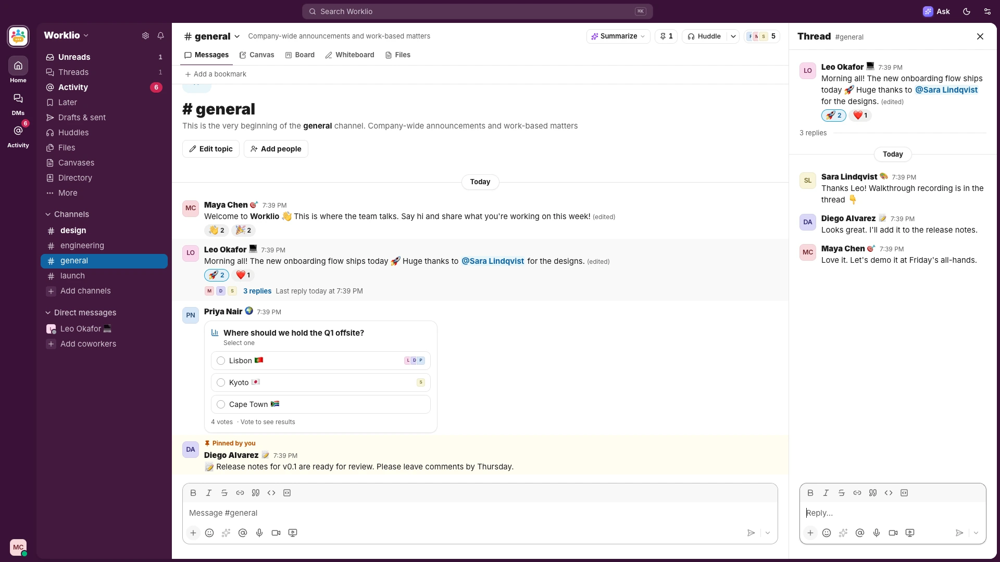
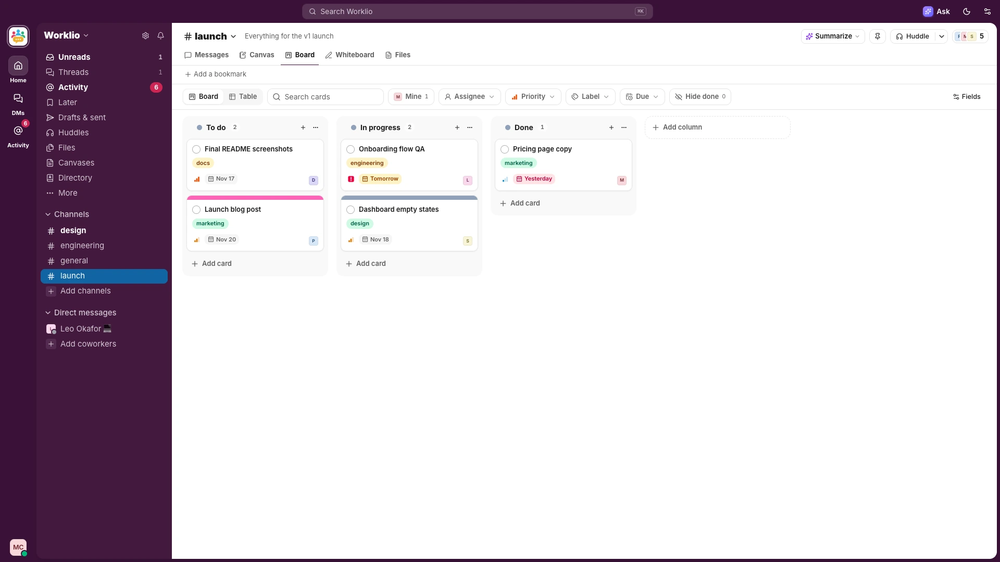
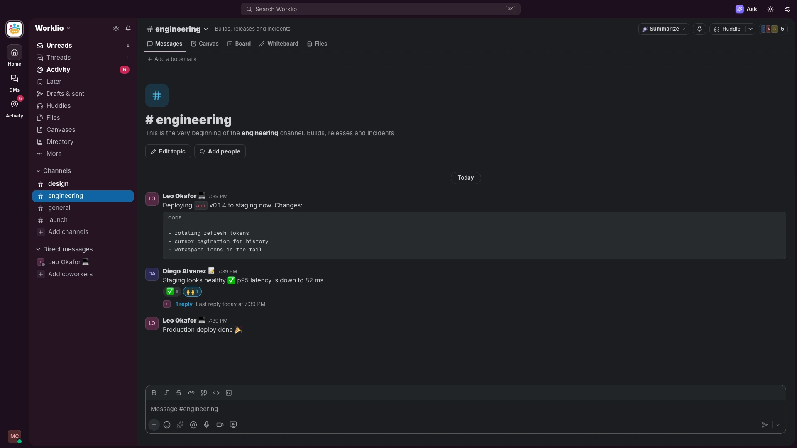
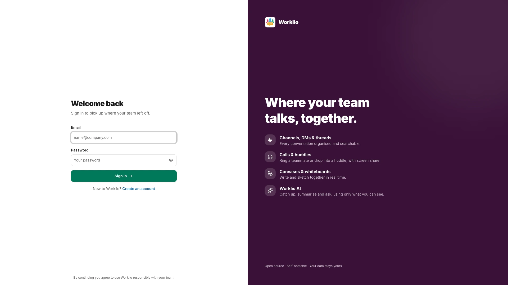

<p align="center">
  
</p>

<h1 align="center">Worklio</h1>

<p align="center">
  Open-source team chat with channels, calls, shared docs and boards, and permission-aware AI.
</p>

<p align="center">
  
</p>

Worklio is a self-hostable workspace for teams. It has channels and DMs, threads, ringing calls
and huddles, a live whiteboard, collaborative docs, boards, voice and video clips, and an AI
assistant that only sees what the asking user is allowed to see. It is MIT licensed. You are free
to use it, change it and build on it.

> **Status:** early (0.1.0). It works end to end in local development and has a large backend test
> suite, but it has not been hardened by production use yet. See [Known limitations](#known-limitations).

## Screenshots

| Channels, reactions, polls and pins | Threads beside the conversation |
|---|---|
|  |  |
| **Boards with priorities, labels and due dates** | **Dark mode, code blocks and unread markers** |
|  |  |
| **Sign in** | |
|  | |

Screenshots are 1920×1080 (click to open full size) and use a demo workspace with fictional
people. Recreate it with `python3 scripts/seed_demo.py /tmp/worklio-demo.json`.

## Features

**Messaging**
- Public and private channels, DMs and group DMs, threads, reactions, edit and delete, edit history.
- Rich text, @mentions, `@here` / `@channel` / `@everyone`, user groups, emoji picker.
- File uploads, voice messages, video clips and screen recordings.
- Pinned messages, channel bookmarks, forwarding, polls, scheduled send, slash commands.
- Link previews fetched server side with SSRF protection.
- Typing indicators, presence, unread counts, read receipts, drafts, jump to message, search.

**Navigation and productivity**
- Workspace rail, ⌘K switcher, multiple workspaces.
- Activity, Threads, Unreads, Drafts & sent, Later (saved items and to-dos), reminders.
- Files browser, people and channel directories, huddle history.
- Custom sidebar sections, per-channel notification settings and mute, Do Not Disturb, status.

**Calls and huddles** (LiveKit)
- Ringing audio/video calls with incoming, missed, declined and cancelled states.
- Channel huddles with join/leave sounds and a live banner.
- Screen share with annotation, in-call notes and chat, background blur and virtual backgrounds.
- Live captions (browser speech recognition) and AI call summaries.

**Collaboration**
- Whiteboard (Excalidraw) with live cursors, usable inside calls.
- Canvas docs (TipTap) with real-time co-editing over Yjs, comments and templates.
- Boards and lists: Kanban and table views, custom fields, subtasks, card comments.
- Screen recording with a camera bubble, drawing and trimming.

**Worklio AI** (Claude, Gemini or DeepSeek)
- Ask Worklio (Q&A with cited sources), Catch me up, channel and thread summaries.
- Composer assistant (rewrite, fix grammar, translate), message translation, thread → tasks.
- An `@worklio` agent you can add to channels.
- Retrieval goes through Worklio's permission-checked search, so the AI never sees messages the
  asking user cannot read.

**Admin and trust**
- Roles (owner, admin, member, guest), workspace policies, member management, invite links.
- Audit log, workspace settings and icon, encrypted per-workspace AI keys.

**Appearance**
- 8 themes with dark variants, light/dark/system mode, custom accent colour, 6 fonts,
  4 text sizes, compact density, reduced motion, resizable sidebar and focus mode.

The full feature list and its status live in [docs/PRODUCT_BLUEPRINT.md](docs/PRODUCT_BLUEPRINT.md).

## Tech stack

| Layer | Technology |
|---|---|
| API | Python 3.12+ (Docker uses 3.13), FastAPI, async SQLAlchemy 2, Alembic, Pydantic |
| Database | PostgreSQL 17 (`pgvector/pgvector:pg17` image) |
| Realtime and cache | Redis 7 (pub/sub, presence, rate limits) over a single WebSocket per tab |
| Background jobs | Celery worker and Celery beat (Redis broker) |
| Files | Any S3-compatible store; SeaweedFS in development |
| Calls | LiveKit server 1.9 |
| Collaboration | Yjs on the client, pycrdt on the server, Excalidraw |
| AI | Anthropic SDK (Claude), OpenAI-compatible SDK (Gemini, DeepSeek) |
| Web app | Next.js 16 (App Router), React 19 (React Compiler lint rules), TypeScript, Tailwind CSS v4, shadcn/ui on Base UI, TipTap v3, livekit-client |

## Quick start

You need Docker (with Compose), Node.js 22 and npm.

```bash
git clone https://github.com/tanveersultan53/worklio.git && cd worklio
cp .env.example .env            # dev defaults, no edits needed
make up                         # builds and starts every backend service (see table below)
cd frontend && npm install && npm run dev
```

Open http://localhost:3000, create an account and a workspace.

- `make up` runs `docker compose up -d --build`. It starts Postgres, Redis, SeaweedFS, the API,
  the Celery worker, Celery beat and LiveKit. The API applies migrations on start.
- `make web` is a shortcut for `cd frontend && npm run dev`.
- The web app talks to `http://localhost:8000` by default. To change that, copy
  `frontend/.env.example` to `frontend/.env.local` and edit it.
- AI is optional. Set `ANTHROPIC_API_KEY` in `.env`, or add a Claude, Gemini or DeepSeek key in
  **Workspace settings → AI**. Without a key, AI endpoints answer `503 ai_not_configured`.

### Services and ports

| Service | Compose name | Host port | Notes |
|---|---|---|---|
| Web app | (runs on host) | 3000 | `npm run dev` |
| API | `api` | 8000 | OpenAPI docs at http://localhost:8000/docs, WebSocket at `/ws` |
| Postgres | `postgres` | 5432 | user/password/db `worklio` |
| Redis | `redis` | 6380 (→ 6379) | 6380 avoids clashing with a local Redis |
| S3 (SeaweedFS) | `s3` | 8333 | creds in `infra/seaweedfs/s3.json`, must match `.env` |
| LiveKit | `livekit` | 7880, 7881, 7882/udp | `--dev` mode, key `devkey` / secret `secret` |
| Celery worker | `worker` | none | link previews, AI agent, call summaries |
| Celery beat | `beat` | none | reminders, scheduled sends, orphan-upload cleanup. Must run. |

### Common commands

| Command | What it does |
|---|---|
| `make up` | Build and start all backend services |
| `make down` | Stop them |
| `make logs` | Tail `api` and `worker` logs |
| `make test` | Run the backend tests inside the `api` container (needs the stack running) |
| `make migrate` | Apply Alembic migrations |
| `make revision m="add something"` | Autogenerate a migration from model changes |
| `make api-shell` | Open a shell in the `api` container |
| `make web` | Run the Next.js dev server |
| `cd frontend && npx tsc --noEmit && npm run lint` | Type-check and lint the web app |

## Project layout

```
backend/            FastAPI app, Alembic migrations, tests  (see backend/README.md)
  app/api/          routes and deps.py (auth + tenant isolation)
  app/realtime/     WebSocket endpoint, Redis pub/sub hub, huddle state
  app/ai/           AI providers, retrieval tools, agent, captions, key encryption
  app/workers/      Celery app, periodic and background tasks
  app/models/       SQLAlchemy models
frontend/           Next.js web app  (see frontend/README.md)
  src/app/          routes (/login, /new, /invite/[token], /w/[workspaceId]/...)
  src/components/   feature folders (chat, workspace, calls, huddle, canvas, board, ai, admin, ...)
  src/lib/          API client, realtime reducers, appearance, stores
  src/hooks/        use-realtime (WebSocket), use-message-jump
infra/seaweedfs/    dev S3 credentials
docs/               architecture, configuration, deployment, roadmap, lessons learned
```

## Documentation

| Document | What it covers |
|---|---|
| [docs/ARCHITECTURE.md](docs/ARCHITECTURE.md) | System design, realtime flow, design rules, WebSocket events, subsystems |
| [docs/CONFIGURATION.md](docs/CONFIGURATION.md) | Every environment variable, with defaults |
| [docs/DEPLOYMENT.md](docs/DEPLOYMENT.md) | Running Worklio in production with Docker |
| [docs/PRODUCT_BLUEPRINT.md](docs/PRODUCT_BLUEPRINT.md) | Feature list, status and delivery waves |
| [docs/ROADMAP.md](docs/ROADMAP.md) | What comes next |
| [docs/LESSONS_LEARNED.md](docs/LESSONS_LEARNED.md) | Pitfalls we hit and how we fixed them |
| [backend/README.md](backend/README.md) | Working on the API |
| [frontend/README.md](frontend/README.md) | Working on the web app |
| [CONTRIBUTING.md](CONTRIBUTING.md) | How to contribute |
| [CODE_OF_CONDUCT.md](CODE_OF_CONDUCT.md) | Community standards |
| [SECURITY.md](SECURITY.md) | Reporting vulnerabilities, security model, production checklist |
| [CHANGELOG.md](CHANGELOG.md) | Release notes |

## Known limitations

- The message list is not virtualized (very long scroll-backs keep every loaded message in the page).
- Threads load up to 2,000 replies; search pages up to 1,000 results.
- Member and channel lists load in full (fine for hundreds of people, not tens of thousands).
- No web push, email invitations, PWA, huddle recording or calendar yet.
- No Playwright end-to-end suite yet.

See [docs/ROADMAP.md](docs/ROADMAP.md) for what's planned.

Before running Worklio anywhere other than your laptop, read the production checklist in
[SECURITY.md](SECURITY.md).

## Contributing

Contributions are welcome. Read [CONTRIBUTING.md](CONTRIBUTING.md) for setup, checks and the
pull request checklist, and follow the [Code of Conduct](CODE_OF_CONDUCT.md). Please report
security issues privately as described in [SECURITY.md](SECURITY.md).

## License

[MIT](LICENSE) © 2026 Muhammad Tanveer Sultan and Worklio contributors.

## Trademarks

Worklio is an independent open-source project. It is not affiliated with, sponsored by or endorsed
by Slack Technologies, LLC or Salesforce, Inc. "Slack" is a trademark of its owner, and any mention
of it here is only for comparison.
