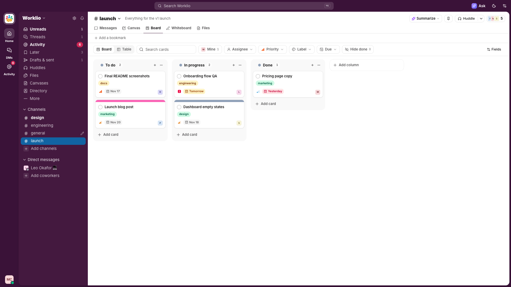

<p align="center">
  
</p>

<h1 align="center">Worklio</h1>

<p align="center">
  <strong>自托管的开源团队聊天工具。</strong><br>
  频道、讨论串、通话与语音会议、共享文档、看板和 AI，全部运行在你自己的服务器上。
</p>

<p align="center">
  <a href="https://github.com/tanveersultan53/worklio/actions/workflows/ci.yml"></a>
  <a href="https://github.com/tanveersultan53/worklio/releases"></a>
  <a href="LICENSE"></a>
</p>

<p align="center">
  <a href="README.md">English</a> ·
  <b>简体中文</b> ·
  <a href="README.ja.md">日本語</a> ·
  <a href="README.ko.md">한국어</a> ·
  <a href="README.es.md">Español</a> ·
  <a href="README.fr.md">Français</a> ·
  <a href="README.de.md">Deutsch</a> ·
  <a href="README.pt-BR.md">Português</a> ·
  <a href="README.ar.md">العربية</a> ·
  <a href="README.ur.md">اردو</a>
</p>

> 本文是英文 README 的翻译版本。如有出入，以 [英文版](README.md) 为准。

<p align="center">
  
</p>

## 我们为什么打造 Worklio

团队聊天已经成为公司完成工作的地方，但大多数团队只是在“租用”它：

- **账单随人数增长。** 托管聊天通常按人按月收费。多招十个人，即使别的都没变，费用也会上涨。
- **你的对话存放在别人的服务器上。** 决策、客户信息、计划和文件都保存在供应商的数据库里，受制于他们的政策和数据所在地区。
- **你被锁定了。** 历史记录限制、导出限制以及只在高价套餐提供的功能，让你很难离开。
- **AI 附带条件。** AI 功能往往需要额外付费，并会把你的消息发送到你没有选择的服务。

Worklio 是另一种选择：一个完整、现代、由你**自己运行**的团队聊天工具。它采用 MIT 许可证，你可以永久免费使用、修改和二次开发。

## 自托管带来的改变

| | 常见的托管团队聊天 | Worklio |
|---|---|---|
| **费用** | 每人每月收费 | 软件免费，只需支付服务器费用 |
| **数据存放位置** | 供应商的云 | 你的服务器、你的地区、你的备份 |
| **消息历史** | 低价套餐常有限制 | 不限，数据库归你所有 |
| **源代码** | 闭源 | 开源（MIT），可阅读、审计和修改 |
| **AI** | 额外收费，模型由供应商决定 | 自带密钥：Claude、Gemini 或 DeepSeek |
| **迁出** | 导出与迁移 | 无需迁出，你本来就拥有它 |

**举个例子。** 按每人每月 10 美元的示例价格计算，50 人的团队每年要付 **6,000 美元**，增长到 100 人时为 **12,000 美元**。Worklio 运行在一台服务器上，按每月 40 美元的示例成本计算，每年约 **480 美元**，无论是 20 人还是 200 人。实际数字会不同，但规律不变：托管聊天随人数增长，Worklio 随硬件增长。

## 你将获得什么

### 交流：井井有条的对话

频道、私信和讨论串，支持表情回应、投票、置顶、书签、定时发送、斜杠命令和搜索筛选。可以跳转到任何一条消息，无论多久以前。


### 开会：会响铃的通话，随时加入的语音会议

呼叫同事或在频道里发起语音会议。共享屏幕并在上面标注，发送表情、举手，会议笔记自动发到讨论串，还能把白板或看板放到舞台上。通话基于 LiveKit，在你自己的部署中运行。


### 创作：聊天旁边的文档、看板和白板

每个频道都有一份团队实时协作编辑的文档、一个带优先级、标签、截止日期和表格视图的看板，以及一块共享白板。

| | |
|---|---|
|  |  |

### 提问：只看得到你能看到内容的 AI

就工作区内容提问并获得带来源的回答，快速了解繁忙的频道，改写或翻译消息，把讨论串变成任务。Worklio AI 与搜索使用相同的权限检查，永远不会让人看到他打不开的消息。可使用你自己的 Claude、Gemini 或 DeepSeek 密钥，密钥加密存储。

### 管理：权限与信任

角色（所有者、管理员、成员、访客）、在服务器端强制执行的权限、邀请链接、成员管理，以及记录所有敏感变更的审计日志。

**[查看全部 46 个界面及说明 →](docs/SCREENSHOTS.md)**

## 五分钟自托管

你需要 Docker（含 Compose）、Node.js 22 和 npm。

```bash
git clone https://github.com/tanveersultan53/worklio.git && cd worklio
cp .env.example .env
make up
cd frontend && npm install && npm run dev
```

打开 http://localhost:3000，创建账户和工作区，然后在 **工作区设置 → 邀请** 中邀请你的团队。

部署到生产环境：`docker-compose.prod.yml` 可在一台服务器上运行完整服务。详细步骤见 [docs/DEPLOYMENT.md](docs/DEPLOYMENT.md)。

## 你的数据，你做主

- 所有数据都留在你的基础设施中：消息和文件在你的 Postgres 和 S3 兼容存储里，通话经由你自己的 LiveKit 服务器。
- 每个请求都在服务器端强制执行租户隔离。
- 短期会话、轮换的刷新令牌，以及登录频率限制。
- AI 密钥加密存储，绝不记录到日志，也不会再次显示。

## 更多信息

技术参考（服务与端口、命令、项目结构）请见英文文档：

- [README (English)](README.md) · [docs/DEPLOYMENT.md](docs/DEPLOYMENT.md) · [docs/CONFIGURATION.md](docs/CONFIGURATION.md) · [docs/ARCHITECTURE.md](docs/ARCHITECTURE.md)
- [CONTRIBUTING.md](CONTRIBUTING.md) · [GOVERNANCE.md](GOVERNANCE.md) · [SECURITY.md](SECURITY.md) · [CODE_OF_CONDUCT.md](CODE_OF_CONDUCT.md)

## 许可证

[MIT](LICENSE) © 2026 Muhammad Tanveer Sultan 与 Worklio 贡献者。

Worklio 是独立的开源项目，与 Slack Technologies, LLC 或 Salesforce, Inc. 没有任何关联，也未获得其赞助或认可。
