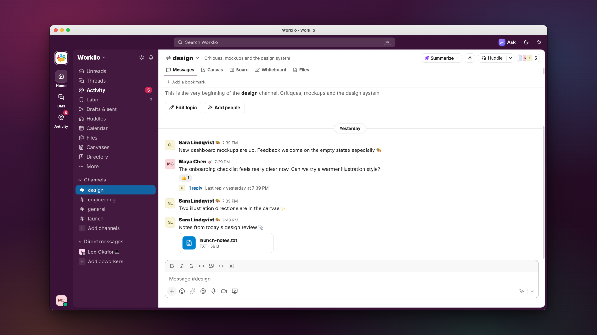

# Worklio Desktop



The Worklio app for macOS, Windows and Linux. It's a small [Electron](https://www.electronjs.org/)
shell around your own Worklio server: everything you see comes from the server, and the shell
adds what a browser tab can't.

- **Unread badge** on the dock (macOS), taskbar (Windows) or launcher (Linux), from the same
  count as the `(3)` in the tab title. New messages bounce the dock icon or flash the taskbar
  when Worklio isn't in front.
- **Notifications** arrive whenever the window isn't focused, not only when it's hidden.
  Clicking one brings Worklio to the front.
- **Screen sharing** in huddles. macOS 15 and later use the system picker; other systems get
  a picker of screens and windows with previews. Windows can share system audio too.
- **Mic and camera** go through the macOS privacy prompts. Servers on plain `http://` over
  your network still get huddles, because the app treats that one address as secure.
- **Runs in the background.** Closing the window hides it so messages and calls still come
  in. Bring it back from the dock (macOS) or the tray icon (Windows, Linux).
- **Other:** it remembers its size and position, runs one copy at a time, opens outside links
  in your browser, and shows spelling suggestions on right-click. Use **View → Back / Forward**
  (`⌘[` / `⌘]`) to move between pages.

## First launch

Worklio asks for your server's address, for example `chat.example.com`, and checks that a
Worklio server answers there. To switch servers later, use **Worklio → Change server…**
(macOS) or **File → Change server…** (Windows, Linux).

## Run from source

You need Node.js 22.

```bash
cd desktop
npm install
npm start                                     # asks for the server address
WORKLIO_URL=http://localhost:3000 npm start   # or skip the question
```

`make desktop` from the repository root does the same against `http://localhost:3000`.

| Variable | What it does |
| --- | --- |
| `WORKLIO_URL` | Server to open, overriding the saved one. |
| `WORKLIO_SYSTEM_PICKER=0` | Use Worklio's screen picker on macOS too (for testing it). |

Settings are kept in `config.json` in the app's data folder:
- macOS: `~/Library/Application Support/Worklio`
- Windows: `%APPDATA%\Worklio`
- Linux: `~/.config/Worklio`

## Build installers

```bash
npm run dist:mac     # .dmg and .zip for Apple silicon and Intel
npm run dist:win     # .exe installer for x64 and arm64
npm run dist:linux   # AppImage and .deb for x64 and arm64
```

Output goes to `desktop/dist/`. Each platform builds best on its own OS.

**Releases:** pushing a `desktop-v0.1.0` tag runs `.github/workflows/desktop.yml`. It builds
on macOS, Windows and Linux and attaches the installers to a **draft** GitHub release, which
the maintainer reviews and publishes. You can also start the workflow by hand from the
Actions tab to get the installers as build artifacts.

### Not signed yet

The builds aren't code-signed yet (macOS gets an ad-hoc signature), so:
- **macOS:** right-click the app → **Open** the first time. If it says the app is damaged, run
  `xattr -dr com.apple.quarantine /Applications/Worklio.app`.
- **Windows:** SmartScreen shows "Windows protected your PC". Choose **More info → Run anyway**.

Signing, notarization and auto-update are next on the list (see `docs/ROADMAP.md`).

## Security

- The Worklio page runs with context isolation and the Chromium sandbox, and has no Node.js.
  It can only bring the window to the front, through `window.worklioDesktop.focus()`.
- Only your server's address can load in the window. Anything else opens in your default
  browser, and `<webview>` is blocked.
- Only your server gets permissions: mic/camera, notifications, clipboard, fullscreen and
  screen capture. Location, USB, MIDI and the rest are refused.
- The setup, offline and screen-picker screens are local files served from
  `worklio-app://`, with a strict Content Security Policy.

## Why Electron

Huddles depend on WebRTC, LiveKit, and background blur/replace (insertable streams and
WebGL). Electron ships the same Chromium on every OS, so calls behave exactly as they do in
Chrome. A system-webview shell like Tauri would run on Safari's WebKit on macOS and WebKitGTK
on Linux, where screen sharing and video effects are limited or missing.

## Layout

```
src/main.js           window, navigation rules, permissions, badge, lifecycle
src/preload.js        the tiny bridge pages can see
src/server.js         normalize and check the server address
src/screen-share.js   getDisplayMedia source picker
src/menu.js           app menu        src/context-menu.js  right-click menu
src/tray.js           Windows/Linux tray icon
src/config.js         settings file
src/ui/               setup, offline and picker screens
build/                icon and macOS entitlements
```
