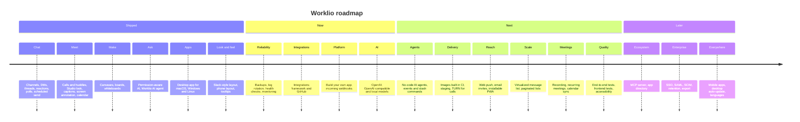
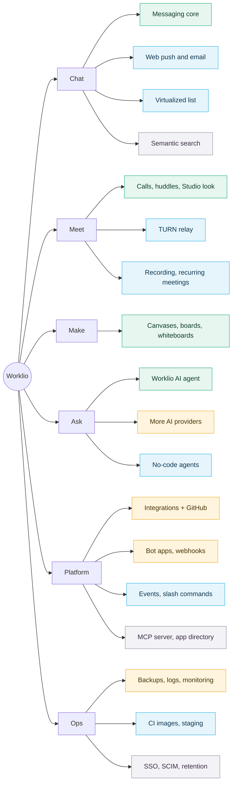
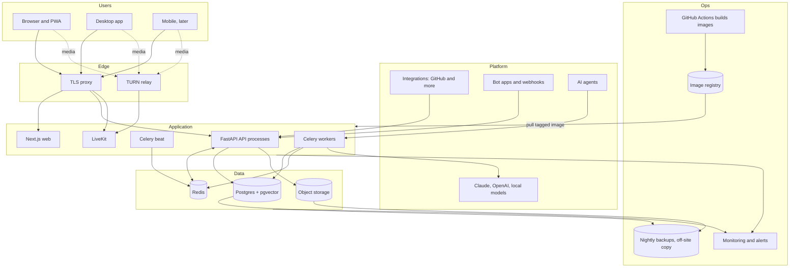

# Roadmap

Where Worklio is going, in three horizons: **Now**, **Next** and **Later**. Every item links to an
issue with the details. The full feature list with the status of each feature is in
[PRODUCT_BLUEPRINT.md](PRODUCT_BLUEPRINT.md). Plans change; to work on something here or propose
something new, open an issue (see [CONTRIBUTING.md](../CONTRIBUTING.md)).

*Last updated: November 2026.*

## At a glance

🟩 shipped · 🟨 now · 🟦 next · ⬜ later

## Now

Being built or next in line.

### Reliability first

The live server works, but it isn't protected yet. These come before new features.

| Item | Why | Issue |
|---|---|---|
| Automated backups and a tested restore | Today a lost disk would lose every message and file | [#105](https://github.com/tanveersultan53/worklio/issues/105) |
| Rotate container logs | Unbounded logs can fill a shared disk | [#106](https://github.com/tanveersultan53/worklio/issues/106) |
| Health checks on every container | A hung web app should be restarted automatically | [#15](https://github.com/tanveersultan53/worklio/issues/15) |
| Monitoring, error tracking and alerts | Know about outages and errors before users do | [#109](https://github.com/tanveersultan53/worklio/issues/109) |

### Integrations and apps

| Item | Issue |
|---|---|
| Integrations framework, with GitHub as the first provider (repo → channel, per-event toggles, rich cards) | [#114](https://github.com/tanveersultan53/worklio/issues/114) |
| Build your own app: bot user, bot token, Web API (`chat.postMessage` …) | [#81](https://github.com/tanveersultan53/worklio/issues/81) |
| Incoming webhooks | [#82](https://github.com/tanveersultan53/worklio/issues/82) |

### AI

| Item | Issue |
|---|---|
| OpenAI, OpenAI-compatible (Azure, OpenRouter) and local models (Ollama, LM Studio) | [#113](https://github.com/tanveersultan53/worklio/issues/113) |

## Next

| Area | Item | Issue |
|---|---|---|
| **Agents** | No-code AI agents: instructions, tools, triggers, schedules | [#84](https://github.com/tanveersultan53/worklio/issues/84) |
| | Events and slash commands for apps | [#83](https://github.com/tanveersultan53/worklio/issues/83) |
| **Delivery** | Build images in CI, deploy by pulling tagged images, one-command rollback | [#107](https://github.com/tanveersultan53/worklio/issues/107) |
| | Staging environment | [#108](https://github.com/tanveersultan53/worklio/issues/108) |
| | Resource limits and a dedicated production host | [#111](https://github.com/tanveersultan53/worklio/issues/111) |
| **Calls** | TURN / TLS relay for strict corporate networks | [#110](https://github.com/tanveersultan53/worklio/issues/110) |
| | Huddle recording to Files | [#20](https://github.com/tanveersultan53/worklio/issues/20) |
| | Recurring meetings, a webcal feed, two-way Google / Outlook sync | [#24](https://github.com/tanveersultan53/worklio/issues/24) |
| **Reach** | Web push notifications | [#18](https://github.com/tanveersultan53/worklio/issues/18) |
| | Email invitations | [#19](https://github.com/tanveersultan53/worklio/issues/19) |
| | Installable PWA with an offline shell | [#32](https://github.com/tanveersultan53/worklio/issues/32) |
| **Scale** | Virtualize the message list | [#16](https://github.com/tanveersultan53/worklio/issues/16) |
| | Paginate member and channel lists | [#17](https://github.com/tanveersultan53/worklio/issues/17) |
| **Quality** | Playwright end-to-end tests (two-account flows) | [#21](https://github.com/tanveersultan53/worklio/issues/21) |
| | Split large frontend components, add unit tests | [#112](https://github.com/tanveersultan53/worklio/issues/112) |
| | Accessibility audit | [#22](https://github.com/tanveersultan53/worklio/issues/22) |

## Later

| Area | Item | Issue |
|---|---|---|
| **Ecosystem** | Worklio MCP server and an app directory | [#85](https://github.com/tanveersultan53/worklio/issues/85) |
| **Search** | Semantic search (hybrid with keyword search) | [#33](https://github.com/tanveersultan53/worklio/issues/33) |
| | Saved searches | [#26](https://github.com/tanveersultan53/worklio/issues/26) |
| **Admin** | Message retention policies | [#30](https://github.com/tanveersultan53/worklio/issues/30) |
| | Workspace data export | [#29](https://github.com/tanveersultan53/worklio/issues/29) |
| | Allowed email domains for automatic joining | [#28](https://github.com/tanveersultan53/worklio/issues/28) |
| | SSO / SAML and SCIM | — |
| **Fun** | Custom emoji upload | [#27](https://github.com/tanveersultan53/worklio/issues/27) |
| **Everywhere** | Internationalization | [#23](https://github.com/tanveersultan53/worklio/issues/23) |
| | Desktop: code signing, auto-update, `worklio://` links, several servers | — |
| | Mobile apps | — |

Small fixes anyone can pick up: [#10](https://github.com/tanveersultan53/worklio/issues/10),
[#11](https://github.com/tanveersultan53/worklio/issues/11),
[#12](https://github.com/tanveersultan53/worklio/issues/12),
[#13](https://github.com/tanveersultan53/worklio/issues/13),
[#14](https://github.com/tanveersultan53/worklio/issues/14).

## Infrastructure and architecture

### What stays

The core design holds up and stays as it is:

- **One backend, one event bus.** FastAPI is a modular monolith. Every API process holds its own
  WebSockets and listens to Redis, so you can run several behind a load balancer.
- **Postgres is the source of truth.** Writes commit first, then the event goes out. Redis only
  carries events and short-lived state.
- **Tenant isolation in one place** (`backend/app/api/deps.py`). Non-members get 404.
- **Background work in Celery**, with beat for schedules.

### Where it's weak today

| Risk | Today | Fix | Issue |
|---|---|---|---|
| 🔴 No backups | A lost disk loses everything | Nightly database and file backups, a tested restore, an optional off-site copy | [#105](https://github.com/tanveersultan53/worklio/issues/105) |
| 🔴 No monitoring | Outages and errors go unnoticed | Uptime checks, error tracking, alerts | [#109](https://github.com/tanveersultan53/worklio/issues/109) |
| 🟠 Unbounded logs | Can fill a shared disk | Cap logs per container | [#106](https://github.com/tanveersultan53/worklio/issues/106) |
| 🟠 Builds on the live server | Each deploy eats the host's CPU and memory; no fast rollback | Build in CI, pull tagged images | [#107](https://github.com/tanveersultan53/worklio/issues/107) |
| 🟠 Missing health checks | A hung container isn't restarted | Health checks on every service | [#15](https://github.com/tanveersultan53/worklio/issues/15) |
| 🟡 No staging | Changes go straight to production | A staging copy that main deploys to first | [#108](https://github.com/tanveersultan53/worklio/issues/108) |
| 🟡 Calls need open UDP/TCP ports | Calls fail behind strict firewalls | TURN over TLS on 443 | [#110](https://github.com/tanveersultan53/worklio/issues/110) |
| 🟡 Shared 4 GB host, no limits | One app can starve the others | Memory limits, a dedicated host | [#111](https://github.com/tanveersultan53/worklio/issues/111) |
| 🟡 Large frontend files, no frontend or end-to-end tests | Changes are harder to make safely | Split modules, Vitest and Playwright in CI | [#112](https://github.com/tanveersultan53/worklio/issues/112), [#21](https://github.com/tanveersultan53/worklio/issues/21) |

### Where we're going

What changes, in order:

1. **Protect the data:** backups, log limits and health checks.
2. **See problems:** monitoring and alerts.
3. **Ship safely:** CI-built images, staging, one-command rollback.
4. **Reach everyone:** TURN for calls, web push and email.
5. **Grow:** the integrations, apps and agents platform on top of the same backend.
